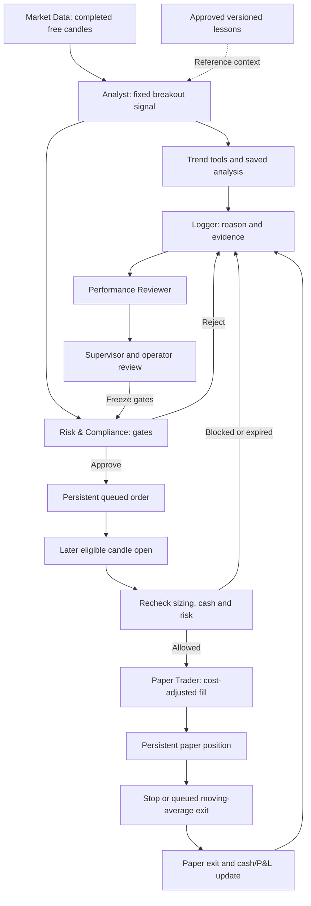

# Trading Desk App Flow

Version 1.1 | 10 October 2026 | Owner: Trading Desk

Baseline: [source commit a8e8ed0](https://github.com/pcgenie575/Trading-desk/tree/a8e8ed0f6a3a04bc8d63613fdf75397a4099729d), checked against the retained source. Deployment evidence is the verification recorded on 10 October 2026 Perth time. This documentation update does not change trading rules or certify today’s live health. “Proposed” items require implementation and acceptance.

## Navigation and access

Open the [dashboard](https://tcr.161-33-69-185.sslip.io/) and use the existing private dashboard login. No public registration flow exists. Navigation links lead to agents, coverage, journal, playbook, learning library, audit feed, [Analyst Brain](https://tcr.161-33-69-185.sslip.io/analyst) and [Research Lab & Knowledge](https://tcr.161-33-69-185.sslip.io/research). Market timestamps use New York time; the trade calendar defaults to Perth and offers New York. Calendar weeks run Monday–Sunday. Weekly decision reports use completed New York weeks.

A separate control token is requested when changing desk controls, trade reviews or knowledge records, or starting research. Keep it out of URLs, shared notes and GitHub. A failed login is an access problem; it does not by itself prove the server is offline.

## Autonomous paper journey

The scheduler wakes every five minutes. It prioritises positions and pending orders, then rotates a scanner symbol. Open/pending symbols normally receive a fetch every 15 minutes; a scanner symbol has a one-hour minimum between fetches. Budget caps can delay either. Each symbol has its own processed-bar checkpoint; duplicate bars create no duplicate trade.

The Analyst checks a completed close above the 50-bar average and prior 10-bar high. Initial risk approval queues a buy, rather than filling the signal close. The opening used must be at least four hours plus 15 minutes after the signal candle timestamp and after the actual recorded decision. The fill is reconstructed when delayed candle data arrives. Quantity/cost/risk are checked again. A seven-day-old pending entry expires when next processed.

Existing positions receive exit priority. A touched protective stop uses the lower of stop and opening price when the market gaps down. A completed close below the 20-bar average queues a later opening exit. Research trailing/time/partial exits do not operate in the active paper desk. Orders and protective stops are simulated from delayed OHLC, not real-time broker orders.

## Operator journeys

1. Check desk state and coverage timestamps, then click an agent to inspect its latest messages. Data-motion animation represents newly received audit events, not proof of live model conversation.
2. Open the journal/calendar. Closed profits are green, losses red; open/holding/breakeven records stay neutral. Click a trade to see its original plan, costs and review.
3. Save review status, adherence assessment, a rule-break tag and observations. Missing legacy plans are never manufactured. Export journal JSON or print the visible report when needed.
4. In the lab, create a lesson, hypothesis or experiment note. Save a draft, add evidence/limitations, assign roles and approve a lesson. Only approved lesson records enter future agent reference context. Archive to stop new references; revisions and prior trade snapshots remain.
5. Run a fixed comparison from saved free candles or a source-labelled JSON import. Every variant is retained. Same data/protocol returns its original run; overlapping historical test dates are labelled reused. Read passive comparisons and export results/frozen data.
6. Read weekly decisions and reserved forward-plan progress. These recommend review; they do not automatically change strategies. Freeze/resume are explicit controls, and resume can be rejected while a breaker remains active.

## Inspect the Analyst Brain

Select Analyst → Open Analyst Brain → choose a US instrument → inspect chart, conditions, flags, approved lessons and paper experience → load saved history. Page refresh reads cached data and costs no provider requests. Candidate analysis carries an immutable report; custom lessons remain reference context. See [Analyst Brain guide](../ANALYST_BRAIN.md) for calculations, use and limitations.

## States and failure handling

| State | Meaning | Operator response |
| --- | --- | --- |
| WATCH / no candidate | Entry rules not met | Continue observing; activity is not a promise to trade |
| ENTRY_QUEUED / ORDER_WAIT | Awaiting an opening after decision time | Inspect pending order and source timestamps |
| REJECTED / FILL_REJECTED | Risk or execution condition failed | Read the reason; do not bypass a cap to force a trade |
| FEED_ERROR / NO_COMPLETED_DATA | Provider data unavailable | Inspect coverage and audit; health may still be green |
| BUDGET_WAIT | Request allowance reserved/exhausted | Wait for capacity; avoid repeated manual cycles |
| FROZEN | Breaker, recovery gap or scheduler failure | Preserve evidence; investigate before attempting resume |
| 401 | Missing/invalid dashboard or control credential | Use the appropriate private credential |
| 409 on lesson save | Another revision won or installed lesson is read-only | Preserve edits, reload, or create a related draft |
| FAILED / INTERRUPTED experiment | Trial did not complete | Keep history; investigate rather than deleting a losing/failed attempt |

See [technical requirements](technical-requirements.md) for access/API rules and [schema](backend-schema.md) for persistent state.

## Specialty agent brains — 10 October 2026

The six remaining agents now have role-specific diagnostics, approved assigned lessons and persistent evidence reports. [Open Agent Brains](https://tcr.161-33-69-185.sslip.io/brains). Read [the specialty guide](../AGENT_BRAINS.md) for tools, interpretation, history and limits. Validation: 31 backend tests and interface logic checks. These descriptive previews leave trading/risk/research rules unchanged.

## Decision controls release — 10 October 2026

[Open Decision Evidence](https://tcr.161-33-69-185.sslip.io/controls). New proposals carry durable single-use signed approvals; execution rechecks risk and the validated opening. Individual risk checks and raw proposal/fill evidence are retained. Session-aware quality gates block missing/stale entries and quarantine suspect prices. Existing signal/exit formulas, numeric limits and the reserved research protocol remain fixed, but stricter gates can prevent entries. New closed-trade attribution preserves regime and decision provenance; missing legacy evidence stays unknown.

Read [Control Boundaries](../CONTROL_BOUNDARIES.md) for exact controls, migration, recovery and limitations. Unsigned legacy pending buys are cancelled with their original payload retained in audit; existing positions and exit queues remain. Validation: 47 backend tests and UI logic checks; live visual review remains incomplete.

## Daily edge research — 10 October 2026

[Edge Research](../EDGE_RESEARCH.md) adds a private `/edge` workspace for cost attribution, fixed daily swing candidates, persistent free-history collection, development-only selection and one historical validation. This is research-only: current paper v1, its cost/risk settings and reserved future-data test remain unchanged. Historical validation and a surviving present-day universe are not proof of a future edge; passing screens cannot activate a strategy.

The schema now includes `edge_lab_runs` (23 tables total). It retains the registered protocol, progress, accepted provider pages, exact dataset hash and results. The collector shares the existing credit gate and resumes saved pages after restart; denied free data stops collection. Detailed datasets/trade logs remain private. Validation: 55 backend tests and Edge Research UI logic checks; the new Edge Research desktop layout and live cost/progress display were inspected in Chrome. Comprehensive mobile/accessibility acceptance remains outstanding.

