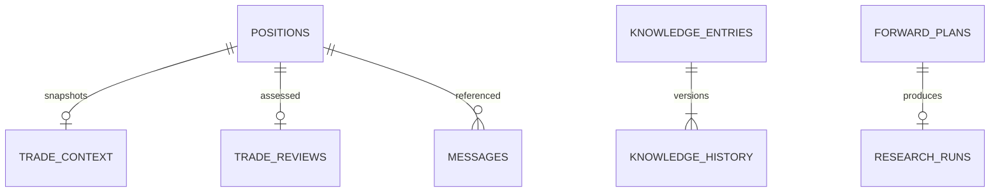

# Trading Desk Backend Schema

Version 1.1 | 10 October 2026 | Owner: Trading Desk

Baseline: [source commit a8e8ed0](https://github.com/pcgenie575/Trading-desk/tree/a8e8ed0f6a3a04bc8d63613fdf75397a4099729d), checked against the retained source. Deployment evidence is the verification recorded on 10 October 2026 Perth time. This documentation update does not change trading rules or certify today’s live health. “Proposed” items require implementation and acceptance.

## Status and persistence

This describes the implemented SQLite database, not a proposed replacement. The host file is `/opt/trading-control-room/data/control_room.db`, mounted as `/data/control_room.db` in the container. Startup creates missing tables and adds recognised columns. It preserves existing records but does not use a versioned migration table. A migration ledger and formal rollback rehearsals are proposed maintenance improvements.

Most identifiers are UUID text. System/audit/update timestamps are UTC ISO strings. Candle and reconstructed trade execution times are naive New York timestamps. Daily loss bookkeeping uses the current New York processing date; it can differ from a recovered historical candle’s execution date. Weekly reports select closed trades by recorded exit timestamp. The frontend interprets New York dates with timezone/DST rules before showing Perth calendar dates.

## Logical relationships

These are application relationships. The current SQL does not declare/enforce foreign-key constraints for them. One-open-position-per-symbol is an application gate, not a unique database constraint. Do not assume database enforcement that the source does not provide.

## Trading and operational tables

| Table | Key | Fields and meaning |
| --- | --- | --- |
| positions | id TEXT PK | symbol, status OPEN/CLOSED, entry_time, entry_price, qty, stop, position_value, planned_loss, exit_time, exit_price, realised field `realized_pnl`, exit_reason, entry_fee, exit_fee, estimated_costs |
| trade_context | trade_id TEXT PK | JSON payload: immutable original candidate, strategy config, risk rules, instrument, curriculum version, approved knowledge versions and entry execution/cost model |
| trade_reviews | trade_id TEXT PK | updated_at, review_status draft/reviewed, followed_rules unknown/yes/partial/no, notes, rule_break tag |
| pending_orders | symbol TEXT PK | side buy/sell, signal_time, JSON payload including queued_at; buys carry candidate, sells carry position ID/reason |
| candles | symbol + interval + bar_time PK | open, high, low, close, volume; deduplicated saved four-hour data |
| state | key TEXT PK | Serialised values: cash/equity/peak, freeze state/reason, per-symbol marks/checkpoints, scan cursor, cycle/fetch/coverage and request-budget counters |
| daily_pnl | trade_date TEXT PK | Accumulated realised P/L for the New York processing day |
| equity_history | ts TEXT PK | equity and peak observations; reports do not invent missing earlier history |
| messages | id TEXT PK | ts, sender, recipient, type, status, reason, JSON data, optional trade_id; includes approved lesson-reference provenance |
| reviews | id TEXT PK | ts, kind and JSON operational review payload |

Quantity remains constant until a full-position exit in the active ledger. There is no live partial-fill/exit table. Partial exit legs exist only inside a research result’s JSON trade log.

## Ledger equations

For a new entry, buy fill price includes spread/slippage; entry_fee includes the order fee and FX allowance. `position_value = qty × entry_price + entry_fee` is the cash cost basis, not merely quoted notional. Cash decreases by that value. Planned loss includes the modeled stop-exit proceeds after exit costs; actual overnight gaps can lose more.

Exit proceeds are `qty × exit_price − exit_fee`. Realised P/L is proceeds minus the stored entry cost basis. Cash increases by proceeds. `estimated_costs` also records embedded spread/slippage for reporting; do not subtract them a second time from P/L.

Reconciliation without deposits/withdrawals:

`cash = 5000 + sum(closed realised P/L) − sum(open position_value)`

`equity = cash + sum(open qty × latest saved mark)`

Unrealised P/L is marked position value minus entry cost basis; it does not precharge a hypothetical exit fee. Legacy cost columns default to zero when migrated. Their original entries are not retroactively rewritten. Missing trade_context remains unavailable rather than fabricated.

## Knowledge tables and revisions

knowledge_entries has id PK, version, updated_at, title, kind lesson/hypothesis/experiment, status draft/in_review/approved/rejected/archived, content, evidence, source_url, JSON agents and builtin flag. Five `book:` entries are seeded once and read-only. Custom entries use UUIDs. Title/content cannot be blank. Field limits are 160/6000 characters for title/content, 4000 for evidence, 800 for source URL and seven assigned roles. Approval requires evidence and a role; only approved lessons enter agent reference context. URLs accept HTTP(S), reject embedded credentials, and are not fetched by agents.

knowledge_history uses entry_id + version as its primary key, with ts and a full record JSON snapshot. Updates require expected_version; stale revisions return 409. Saving entry, history and audit is transactional. Archiving removes future references while preserving history and captured trade context. The current total limit is 250 entries, including archived/installed entries; archiving does not release that capacity.

## Research and weekly tables

research_runs: id PK, ts, symbol, dataset_hash, protocol JSON, test_start, test_end, status, result payload JSON and exact dataset JSON. Protocol/data are saved before calculation. Statuses include RUNNING, COMPLETE, FAILED and INTERRUPTED. Results retain all eight variants, costs, trade legs, equity curves and benchmarks. Dataset fingerprint plus protocol identifies repeated requests in application logic; no SQL unique constraint enforces that pair. Run registration is serialised within the single application process. Manual batches have a 100-record cap; the automated forward path does not share that cap.

forward_plans: id PK, symbol, registered_at, frozen protocol JSON, status and optional run_id. The versioned SPY plan waits for 120 future completed candles, uses 60 preceding warm-up candles, and records all variants once. Protocol mismatch changes a collecting plan to REVIEW_REQUIRED. Startup marks unfinished running plans interrupted; operator investigation is required instead of pretending they completed.

weekly_reports: week PK, ts and JSON payload. The week key is the Monday date of the completed New York week. A report is saved once for the latest completed week; it is not automatically a historical backfill or continuously recalculated after later review edits. It stores sample/expectancy/cost/adherence/failure/drawdown evidence, decision and reasons. Unavailable values are null.

## Analyst analysis snapshots

analyst_reports adds symbol, bar_time, version, context_hash, created_at and JSON payload; primary key is symbol + bar_time + version + context_hash. Input candles, market context and knowledge versions identify each report. INSERT OR IGNORE preserves an existing snapshot. New trade candidate JSON also carries its analysis. History reads are bounded; persistence has no automatic purge. See [Analyst Brain guide](../ANALYST_BRAIN.md) for calculations, use and limitations.

## Transactions, growth and recovery

Trading/knowledge operations use a process-wide reentrant lock and BEGIN IMMEDIATE with rollback on failure. Manual research calculation runs outside the lock after durable registration; results are committed afterwards. Forward research runs in the scheduler’s serialised cycle. This requires a single application process.

The API caps audit reads at 1000 messages, research summaries at 20 per page and weekly reports at 52; these read limits do not delete stored history. Operational candles/audit/equity/history can keep growing. Summary responses omit large curves/trade logs; one-run exports retain them. No general retention purge, export-import restore workflow or encrypted off-server destination is implemented.

Use the online SQLite backup API for consistent backups, validate integrity before restore, and stop the application before replacing its DB. Never commit real ledger/backups, credentials or private reviews to GitHub. See [technical requirements](technical-requirements.md) for access and recovery constraints.

## Specialty agent brains — 10 October 2026

The six remaining agents now have role-specific diagnostics, approved assigned lessons and persistent evidence reports. [Open Agent Brains](https://tcr.161-33-69-185.sslip.io/brains). Read [the specialty guide](../AGENT_BRAINS.md) for tools, interpretation, history and limits. Validation: 31 backend tests and interface logic checks. These descriptive previews leave trading/risk/research rules unchanged.

agent_reports adds role, version, context_hash, created_at and JSON payload; primary key role + version + context_hash. Startup and scheduler attempts persist immutable, deduplicated contexts. History reads default to 20 and cap at 50; no retention purge. The database now has 17 tables.

## Decision controls release — 10 October 2026

[Open Decision Evidence](https://tcr.161-33-69-185.sslip.io/controls). New proposals carry durable single-use signed approvals; execution rechecks risk and the validated opening. Individual risk checks and raw proposal/fill evidence are retained. Session-aware quality gates block missing/stale entries and quarantine suspect prices. Existing signal/exit formulas, numeric limits and the reserved research protocol remain fixed, but stricter gates can prevent entries. New closed-trade attribution preserves regime and decision provenance; missing legacy evidence stays unknown.

Read [Control Boundaries](../CONTROL_BOUNDARIES.md) for exact controls, migration, recovery and limitations. Unsigned legacy pending buys are cancelled with their original payload retained in audit; existing positions and exit queues remain. Validation: 47 backend tests and UI logic checks; live visual review remains incomplete.

New additive tables: proposals (id PK, ts, symbol, payload, digest), risk_decisions (id PK, proposal_id, ts, phase, decision, payload), decision_consumptions (approval_id PK, unique trade_id, ts), quality_reports (symbol + context_hash PK, ts, payload). Total: 22 tables; candle_revision_reviews retains reviewed corrections. Approval consumption/position/cash commit atomically; reads do not consume approvals. Latest quality reports use persisted state keys. No automatic retention purge or SQL foreign-key enforcement is added.

candle_revision_reviews: id PK, symbol, ts, quality_hash, reason and original/accepted candle JSON. Token-protected, expected-hash review accepts only isolated historical revisions with no active symbol position/order; it cannot clear a freeze automatically.

## Daily edge research — 10 October 2026

[Edge Research](../EDGE_RESEARCH.md) adds a private `/edge` workspace for cost attribution, fixed daily swing candidates, persistent free-history collection, development-only selection and one historical validation. This is research-only: current paper v1, its cost/risk settings and reserved future-data test remain unchanged. Historical validation and a surviving present-day universe are not proof of a future edge; passing screens cannot activate a strategy.

The schema now includes `edge_lab_runs` (23 tables total). It retains the registered protocol, progress, accepted provider pages, exact dataset hash and results. The collector shares the existing credit gate and resumes saved pages after restart; denied free data stops collection. Detailed datasets/trade logs remain private. Validation: 55 backend tests and Edge Research UI logic checks; the new Edge Research desktop layout and live cost/progress display were inspected in Chrome. Comprehensive mobile/accessibility acceptance remains outstanding.

## Portfolio evidence release — 10 October 2026

There are now 24 SQLite tables. The added trade_excursions table has trade_id as primary key and a JSON payload containing original price/quantity/risk, observed extrema, last bar, coverage and ordering flags. edge_lab_runs now also stores PORTFOLIO diagnostics. Original trade_context snapshots and all earlier results remain intact.

See [Portfolio Evidence](../PORTFOLIO_EVIDENCE.md) for exact protocol, negative results and remaining evidence gates.

## ETF input and portfolio evidence

[ETF Research guide](../ETF_RESEARCH.md) explains the fixed five-market experiment, raw-price fills, split/distribution accounting, shared risk gates and agent evidence report. [Open the private workflow](https://tcr.161-33-69-185.sslip.io/etf-research). Missing corporate-action coverage blocks performance calculations; this workflow does not activate a strategy. The schema remains at 24 tables and the current test suite has 68 passing tests.
# Controlled learning migration (prepared, not yet deployed)

`controlled-learning-v1` adds `learning_cycles` (immutable completed-week evidence snapshots), `learning_approvals` (operator lesson approvals), and `learning_tests` (one frozen exit experiment with development/forward datasets). Existing tables and paper records are preserved. Once installed and the first worker checkpoint runs, the schema has 27 tables. Public source contains no private records. See [Controlled Learning](../CONTROLLED_LEARNING.md).

