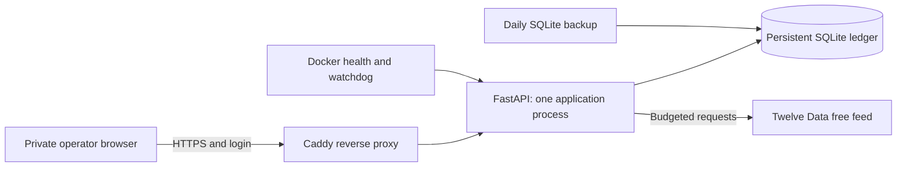

# Trading Desk Technical Requirements

Version 1.1 | 10 October 2026 | Owner: Trading Desk

Baseline: [source commit a8e8ed0](https://github.com/pcgenie575/Trading-desk/tree/a8e8ed0f6a3a04bc8d63613fdf75397a4099729d), checked against the retained source. Deployment evidence is the verification recorded on 10 October 2026 Perth time. This documentation update does not change trading rules or certify today’s live health. “Proposed” items require implementation and acceptance.

## Baseline architecture

The existing Oracle Melbourne Ubuntu 24.04 AMD E2.1.Micro VM has 1 GB RAM, approximately 46.6 GB boot storage and 1 GB swap in recorded deployment evidence. Use that existing host; no extra paid resource is part of this baseline. Docker Compose runs the Python application and Caddy. The application port 8000 is internal to the Compose network; public traffic uses 80/443. SSH access is restricted separately to an authorised administration IP. The address is ephemeral, so an IP change also requires hostname/configuration updates.

The runtime uses Python 3.12 in Docker, FastAPI 0.115.6, Uvicorn 0.34.0, Pydantic 2.10.4 and tzdata 2026.2 as retained requirements. These recorded versions are not a certification of current dependency security. Run one worker/container against this ledger: concurrency locks are process-local, not distributed coordination.

## Source and responsibility

| File | Responsibility |
| --- | --- |
| app.py | Authenticated API, ledger, risk gates, scheduler, snapshots, research registration and reports |
| strategy.py | Fixed breakout signal/configuration; historical entry point uses the recorded research protocol |
| execution.py | Estimated fills, fees/FX allowance and cost-aware sizing |
| exposure.py | Static sector/groups and saved-return correlation gates |
| market_data.py | Provider request, symbol/currency/exchange checks, completed valid OHLC |
| universe.py | Explicit symbol scope, request budgets and portfolio limits |
| research_engine.py | Two entries × four exits, later-period metrics and passive benchmarks |
| agent_curriculum.py | Book-informed original lessons, integrity/evidence checks and provenance |
| dashboard.html / journal-ui.js | Desk, agents, journal/calendar and review interactions |
| research.html | Knowledge editing, recorded comparisons, exports and weekly/forward progress |
| compose.oracle.yml / ops | Deployment, health/watchdog and consistent backups |

## Access and configuration

The server environment file `/opt/trading-control-room/.env` holds TWELVE_DATA_API_KEY, TCR_DOMAIN, TCR_DASHBOARD_USER, TCR_DASHBOARD_PASSWORD and TCR_CONTROL_TOKEN. Values must remain private, with restricted file permissions. Never commit production environment files, keys, credentials, database copies or exports containing private records. Startup requires the dashboard password and control token. The API key is needed for autonomous feed operation; it is not a broker key.

HTTPS terminates at Caddy, which manages certificates. Dashboard/API/assets require HTTP Basic authentication except `/healthz`. No-store and no-sniff response headers are set. Explicit operator write controls require the X-Control-Token header as well. The authenticated GET `/review` is an exception to read-only semantics: it records an operational snapshot without a control-token prompt. Automatic scheduler writes are internal operations.

| Interface | Purpose / access |
| --- | --- |
| GET /, /research | Private dashboard/lab |
| GET /status, /coverage, /positions, /messages, /candles, /journal, /training | Private operating/learning records |
| GET /knowledge and /knowledge/{id}/history | Private lessons and revisions |
| POST /knowledge, PUT /knowledge/{id} | Save with control token, validation and version lease |
| PUT /journal/{trade_id}/review | Save assessment with control token |
| POST /freeze, /resume, /cycle | Explicit controls with token; resume still checks breakers |
| GET /review | Record and return operational snapshot |
| GET /experiments, /experiments/{id}, /experiments/{id}/dataset | Paginated summary or one full frozen result/data export |
| POST /experiments, POST /backtest | Token-protected recorded research; backtest delegates to the fixed lab |
| GET /weekly-reports, /forward-plans | Private decision history/collection progress |
| GET /analyst, /analyst-analysis, /analyst-analysis/{symbol}/history | Private page, cached analysis preview and bounded saved snapshots; no control token for reads |
| GET /healthz | Public minimal process/scheduler health; no ledger/credentials |

## Analyst tools and read-only access

analyst_tools.py supplies deterministic Wilder ATR/RSI, trend/slope, aligned relative-return, same-session volume and descriptive flags. Authenticated GET /analyst, /analyst-analysis and /analyst-analysis/{symbol}/history expose the page, read-only preview and bounded history. Startup/new candles persist reports; 26 backend tests passed for this additive release. No active strategy/research protocol change. See [Analyst Brain guide](../ANALYST_BRAIN.md) for calculations, use and limitations.

## Trading and data constraints

Configured request caps are 6/minute, 600 scanner/day and 720 total/day, persisted with UTC budget dates. These are desk safeguards, not promises about provider entitlements. The scanner rotates 18 observed symbols roughly every 90 minutes at the five-minute cadence; actual coverage depends on retries, priority work and budget capacity. US execution is limited to the 16 configured symbols; two crypto symbols remain observation only.

Four-hour candles wait their full interval plus 15 minutes. Fresh entry analysis skips candles more than 24 hours old and historical catch-up entries. Persistent pending orders follow their own eligibility/expiry rules. Recovery gaps freeze the desk. Cached candles supply correlation and normal research; controlled free history refill for the recorded initial study used one budgeted request.

Risk caps: $5,000 starting USD cash, three open positions, $500 all-in entry cost/$25 planned stop loss per new position, $1,500 aggregate entry cost/$75 aggregate planned loss, $75 daily realised-loss stop and $250 peak-to-equity freeze. Additional gates cap sector at $750, combined US equity at $1,000 and a positively correlated cluster at $750. Correlation uses at least 30 aligned saved returns, threshold 0.8 and latest data no older than ten days. Unknown same-group correlation counts as overlap. Existing positions are retained on migration; these caps are entry gates, not promises to cap gap losses.

Estimated per-side execution: 5 bps half-spread, 2 bps slippage, $1 order fee and 35 bps FX allowance. The USD ledger does not simulate actual AUD exchange-rate returns. Legacy entries retain their original costs; new exits use the current model. See [schema](backend-schema.md) for accounting equations.

## Reliability, backup and verification

SQLite is bind-mounted from host `data` to container `/data`; rebuilding the image preserves that volume. Docker restarts exited services. Health checks assess DB access, scheduler thread and recent cycle time; the minute watchdog restarts an unhealthy application. They do not prove recent market data. Unexpected scheduler failures freeze entries for review.

Daily backups use SQLite’s online backup API and retain 14 copies on the VM. A consistent copy was also downloaded locally in verification. Automatic encrypted off-server backups remain unconfigured. Stop the application before restoring a verified DB, preserve the old copy, then validate integrity, ledger and pending orders before resuming. Do not overwrite an active ledger.

Recorded validation: 26 backend tests, JavaScript interaction checks, authenticated HTTPS, scheduler health, restart persistence, preserved entry history and cash reconciliation. Browser visual/accessibility checks remain incomplete. Run tests against disposable databases only. Development dependencies include httpx for API tests; secrets are unnecessary for synthetic fixtures. Unbounded operational history, database growth, restore drills and VM resource trends need continued review; current code has no versioned migration ledger or general API rate-limit layer.

## Specialty agent brains — 10 October 2026

The six remaining agents now have role-specific diagnostics, approved assigned lessons and persistent evidence reports. [Open Agent Brains](https://tcr.161-33-69-185.sslip.io/brains). Read [the specialty guide](../AGENT_BRAINS.md) for tools, interpretation, history and limits. Validation: 31 backend tests and interface logic checks. These descriptive previews leave trading/risk/research rules unchanged.

## Decision controls release — 10 October 2026

[Open Decision Evidence](https://tcr.161-33-69-185.sslip.io/controls). New proposals carry durable single-use signed approvals; execution rechecks risk and the validated opening. Individual risk checks and raw proposal/fill evidence are retained. Session-aware quality gates block missing/stale entries and quarantine suspect prices. Existing signal/exit formulas, numeric limits and the reserved research protocol remain fixed, but stricter gates can prevent entries. New closed-trade attribution preserves regime and decision provenance; missing legacy evidence stays unknown.

Read [Control Boundaries](../CONTROL_BOUNDARIES.md) for exact controls, migration, recovery and limitations. Unsigned legacy pending buys are cancelled with their original payload retained in audit; existing positions and exit queues remain. Validation: 47 backend tests and UI logic checks; live visual review remains incomplete.
